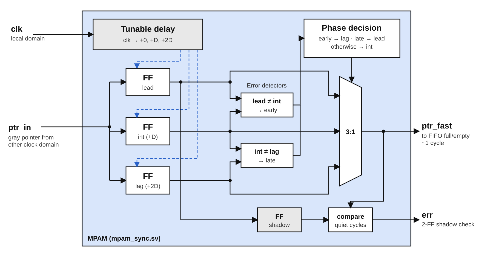

# low-latency-cdc-synchronizer

low latency clock domain crossing for a multi-clock 2x2 network-on-chip.
instead of a 2-3 flop synchronizer on every fifo pointer, MPAM (metastability risk prediction and mitigation) samples the pointer on 3 clock phases and picks the safe one, so the pointer crosses in ~1 cycle.

idea based on: C. Lin et al., "Low-latency clock domain crossing with metastability risk prediction and mitigation", IEEE JSSC 2024

## how it works
- tunable delay makes clk, clk+D, clk+2D
- gray ptr sampled on all 3
- neighbouring samples differ -> ptr changed near those edges
- use the sample furthest from the change (lag if early, lead if late, else int)
- normal 2ff sync runs alongside as a shadow, raises err if they disagree

## files
- mpam_sync.sv - mpam block + fake delay line for sim
- tb_mpam.sv - mpam unit tb w fake metastability model
- local_fifo.sv - dual clock fifo w mpam on both ptr crossings
- router_logic.v, router.sv - xy router, round robin arbiters
- noc_top.sv - 2x2 mesh, 4 clock domains
- noc_top_tb.sv, run_noc_top.sh - traffic tb w scoreboard

## run (cadence xcelium)
    # mpam unit test
    xrun -sv +define+META_MODEL mpam_sync.sv tb_mpam.sv +WPER=13.7

    # full noc (add -define NO_MPAM for plain 3ff sync)
    xrun -sv mpam_sync.sv local_fifo.sv router_logic.v router.sv noc_top.sv noc_top_tb.sv -defparam tb_noc_top.MULTI_CLK=1

## results
mpam unit tb (rclk 100 MHz, wclk 73/137/~100 MHz, 200k cycles, exaggerated metastability model):
- mpam: 0 failures, 1.2-1.4 cycle latency
- 2ff sync: 2.4-2.5 cycles
- single flop: 36-70 failures

full noc, light traffic avg packet latency:

| | 3ff sync | mpam |
|---|---|---|
| 1 clock | 119.8 ns | 59.6 ns (-50%) |
| 4 clocks | 127.7 ns | 71.9 ns (-44%) |

all traffic tests pass (no lost / out of order / corrupt packets). heavy traffic is queue limited so about the same.
